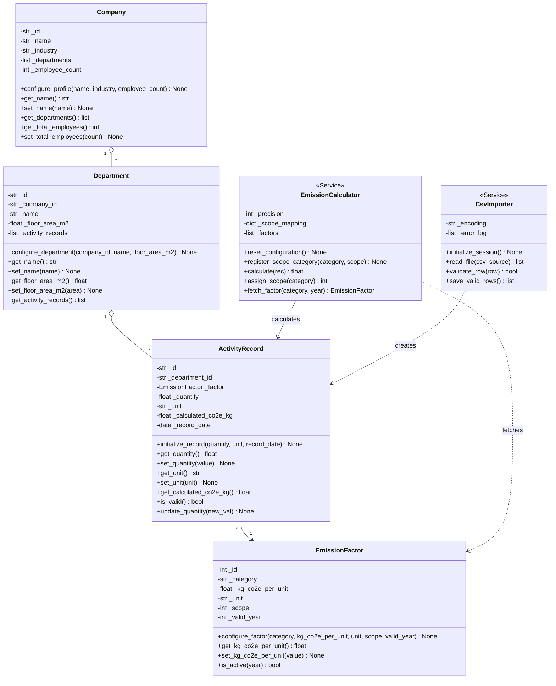
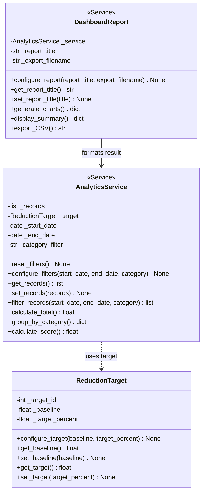
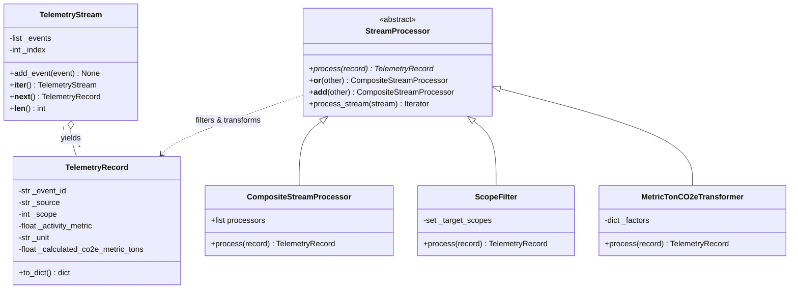
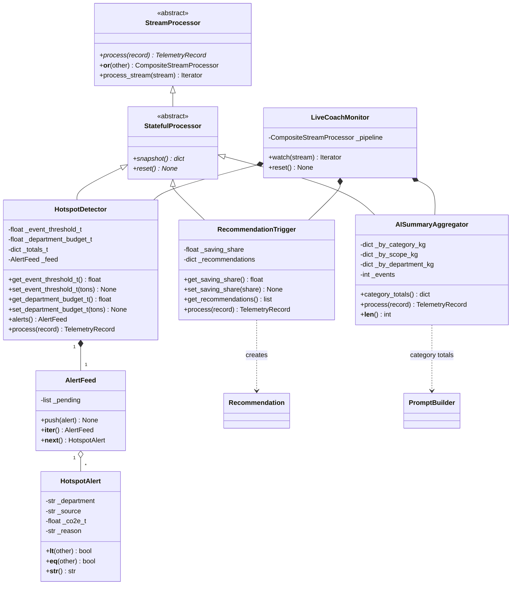

# Enterprise Carbon Footprint Tracker & AI Assistant — Hometask 1 & 2

**Group 13 — Compact Programming, FH Dortmund**

This branch (`HomeworkAssignment2`) builds on `Homeassignment1` by adding our event-driven **Real-Time Telemetry Stream Processing** framework (`app/data_collection/stream_processing.py`) on top of the OOP subsystem classes of our Group 13 Capstone Project UML class diagrams across all three subsystems. Every class implements explicit state initialization (`__init__`), configuration/setup methods, and encapsulated getters & setters with domain validation.

# Video Link: https://drive.google.com/file/d/1GtoecjBTKAF1Ownqjzxyy-tPLzlgtC9f

---

## Team Overview

| Team Member | Program | Matriculation ID | Assigned Subsystem | Implemented OOP Classes (≥ 3 per Member) |
|---|---|---|---|---|
| **Mohammed Al-Amine Bennani** | MDT | `7222047` | **S1 — Data Collection & Calculation** (`app/data_collection/`, `app/models/`) | `Company`, `Department`, `EmissionFactor`, `ActivityRecord`, `EmissionCalculator`, `CsvImporter` |
| **Vanessa Mukamanzi** | MDT | `7223964` | **S2 — Analytics & Dashboard** (`app/analytics/`, `app/models/target.py`) | `ReductionTarget`, `AnalyticsService`, `DashboardReport` |
| **Junaid Ahmad** | MDT | `7222074` | **S3 — AI Assistant & User Access** (`app/user_access/`, `app/ai_assistant/`, `app/models/`) | `User`, `ChatMessage`, `Recommendation`, `AuthService`, `PromptBuilder`, `AIClient`, `AIAssistant` |

---

## Directory Structure

```text
.
├── README.md
├── demo.py                      # Runnable OOP demonstration across S1, S2, and S3
├── demo_s3.py                   # S3 walkthrough: every S3 class (Junaid Ahmad)
├── tests/test_s3_classes.py     # S3 unit tests (standard-library unittest, OpenAI faked)
└── app/
    ├── models/                  # Domain models (Company, Department, EmissionFactor, ActivityRecord, Target, User, ChatMessage, Recommendation)
    ├── data_collection/         # S1 — Mohammed Al-Amine Bennani (7222047): EmissionCalculator, CsvImporter
    ├── analytics/               # S2 — Vanessa Mukamanzi (7223964): AnalyticsService, DashboardReport, CarbonScorer
    ├── user_access/             # S3 — Junaid Ahmad (7222074): AuthService
    └── ai_assistant/            # S3 — Junaid Ahmad (7222074): PromptBuilder, AIClient, AIAssistant
```

---

## System Design (UML Class Diagrams)

### Subsystem 1 — Data Collection & Calculation (Mohammed Al-Amine Bennani · `7222047`)



### Subsystem 2 — Analytics & Dashboard (Vanessa Mukamanzi · `7223964`)



### Subsystem 3 — AI Assistant & User Access (Junaid Ahmad · `7222074`)

```mermaid
classDiagram
    class User {
        -str _id
        -str _company_id
        -str _department_id
        -str _email
        -str _password_hash
        -str _role
        +initialize_account(email, password, role) None
        +get_email() str
        +set_email(email) None
        +get_role() str
        +set_role(role) None
        +set_password(password) None
        +check_password(password) bool
        +has_role(role) bool
    }

    class ChatMessage {
        -str _id
        -str _user_id
        -str _sender
        -str _content
        -datetime _created_at
        +initialize_message(sender, content) None
        +get_sender() str
        +set_sender(sender) None
        +get_content() str
        +set_content(content) None
        +to_dict() dict
    }

    class Recommendation {
        -str _id
        -str _department_id
        -str _title
        -float _est_saving_kg
        -float _est_cost_eur
        -str _effort
        -str _status
        +initialize_recommendation(title, est_saving_kg, effort, est_cost_eur) None
        +get_est_cost_eur() float
        +set_est_cost_eur(cost_eur) None
        +get_status() str
        +set_status(status) None
        +accept() None
        +mark_done() None
        +reject() None
        +to_dict() dict
    }

    class AuthService {
        <<Service>>
        -str _default_company_id
        -dict _users_by_email
        -User _active_user
        +reset_session() None
        +get_active_user() User
        +register(email, password, role, company_id, department_id) User
        +login(email, password) User
        +require_role(role, user) bool
    }

    class PromptBuilder {
        <<Service>>
        -str _system_prompt
        -int _max_hotspots
        +configure_templates(system_prompt, max_hotspots) None
        +get_system_prompt() str
        +set_system_prompt(prompt) None
        +get_max_hotspots() int
        +set_max_hotspots(count) None
        +anonymise(company_id) str
        +build_context(company_id, category_totals) dict
        +chat_messages(context, question, history) list
        +advice_prompt(hotspots, department_name) str
    }

    class AIClient {
        <<Service>>
        -str _api_key
        -str _model
        -float _timeout
        -int _max_tokens
        -int _daily_limit
        -int _requests_today
        +configure(api_key, model, timeout, max_tokens, daily_limit) None
        +reset_usage() None
        +set_api_key(api_key) None
        +get_model() str
        +set_model(model) None
        +get_timeout() float
        +set_timeout(seconds) None
        +is_available() bool
        +complete(messages) str
    }

    class AIAssistant {
        <<Service>>
        -AIClient _client
        -PromptBuilder _prompt_builder
        -list _history
        +configure_assistant(model, clear_history) None
        +get_model() str
        +set_model(model) None
        +get_client() AIClient
        +set_client(client) None
        +ask(user, question, context) ChatMessage
        +recommend(department_id, hotspots) list
        +summarise(month, category_totals) str
    }

    AuthService "1" o-- "*" User : manages
    AIAssistant "1" *-- "1" AIClient : composition
    AIAssistant "1" *-- "1" PromptBuilder : composition
    AIAssistant "1" o-- "*" ChatMessage : history
    AIAssistant ..> Recommendation : creates
    AIAssistant ..> User : answers
```



**S3 design notes (Junaid Ahmad)**

- `AIAssistant` is composed of a `PromptBuilder` (what to ask) and an `AIClient` (how to ask OpenAI).
  Without `OPENAI_API_KEY`, or if OpenAI fails, it answers offline from the same aggregated figures.
- Only aggregated, anonymised figures reach the AI: `PromptBuilder.anonymise()` replaces the company id with a stable SHA-256 pseudonym.
- The API key is write-only (`set_api_key`, `has_api_key`) and never returned by a getter.
- `User` stores passwords only as salted `scrypt` hashes (standard library `hashlib`).
- `Recommendation` enforces its workflow: proposed → accepted → done, or rejected; a rejected or finished tip cannot be reopened.

---

## Running the OOP Verification Demo

No external libraries are required (Python 3.10+ standard library only):

```bash
python demo.py
```

Subsystem 3 walkthrough and unit tests:

```bash
python demo_s3.py
python -m unittest discover tests
```

`demo_s3.py` runs offline. To let the S3 coach answer through OpenAI, `pip install openai` and set `OPENAI_API_KEY`.

---

## Real-Time Stream Processing Pipeline (Hometask 2)

Our event-driven stream processing framework (`app/data_collection/stream_processing.py`) ingests live operational telemetry (`flight_booking`, `server_utility_log`, `freight_logistics`), filters events by GHG Protocol Scope tags (Scope 1, Scope 2, Scope 3), and transforms activity metrics into metric tons of CO₂e emissions:

1. **Abstract Base Classes (ABCs):** `StreamProcessor(ABC)` defines the uniform processor contract with `@abstractmethod def process(record)`.
2. **Inheritance & Polymorphism:** `ScopeFilter`, `MetricTonCO2eTransformer`, and `CompositeStreamProcessor` inherit from `StreamProcessor` and implement `process(record)`.
3. **Operator Overloading:** `StreamProcessor` overloads both `__or__` (`|`) and `__add__` (`+`) for intuitive pipeline composition (`ScopeFilter(3) | MetricTonCO2eTransformer()`).
4. **Iterators & Generators:** `TelemetryStream` implements `__iter__` and `__next__`; `StreamProcessor.process_stream()` lazily `yield`s transformed records.

### Stream Processing Class Diagram



### Subsystem 3 Real-Time Insights (Junaid Ahmad · `7222074`)

`app/ai_assistant/stream_insights.py` plugs S3 into the same framework. The S1 steps and the S3 steps form one pipeline with the overloaded `|` operator:

```python
ScopeFilter({1, 2, 3}) | MetricTonCO2eTransformer() | HotspotDetector() | RecommendationTrigger() | AISummaryAggregator()
```

1. **Abstract Base Class:** `StatefulProcessor(StreamProcessor)` adds the abstract methods `snapshot()` and `reset()` for processors that remember the stream.
2. **Inheritance & Polymorphism:** `HotspotDetector`, `RecommendationTrigger` and `AISummaryAggregator` each implement `process()`, `snapshot()` and `reset()` differently; `LiveCoachMonitor.reset()` resets them all through the same call.
3. **Operator Overloading:** S3 steps join S1 steps with `|`; `HotspotAlert` overloads `<` and `==`, so `sorted(alerts)` / `max(alerts)` order alerts by severity.
4. **Iterators & Generators:** `AlertFeed` implements `__iter__` / `__next__` (each alert delivered once); `LiveCoachMonitor.watch(stream)` is a generator that yields each alert as soon as its event is processed.

What each S3 step does:

- `HotspotDetector` flags an event above a CO₂e threshold, or the event that pushes its department over budget.
- `RecommendationTrigger` turns the first hotspot per department and source into an S3 `Recommendation`.
- `AISummaryAggregator` keeps running totals per category, scope and department. Only these totals go to the AI coach (`PromptBuilder.build_context`), never raw events.



### 5-Minute Walkthrough Video

- **Video Link:**

### Running the Stream Pipeline Demo

```bash
python demo_stream.py
```

Subsystem 3 live insights (alerts, recommendations, AI summary):

```bash
python demo_s3_stream.py
python -m unittest discover tests
```
