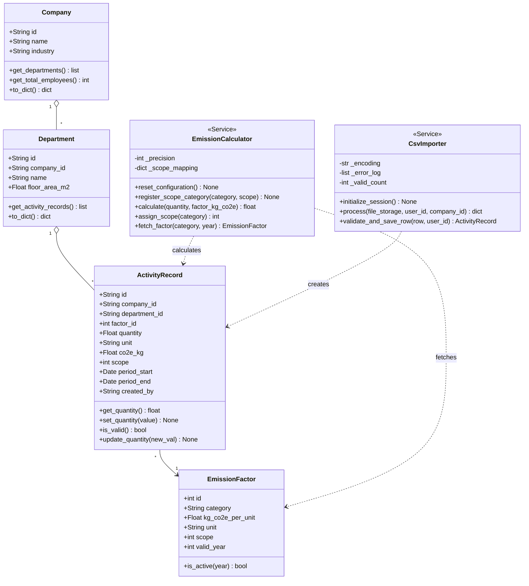
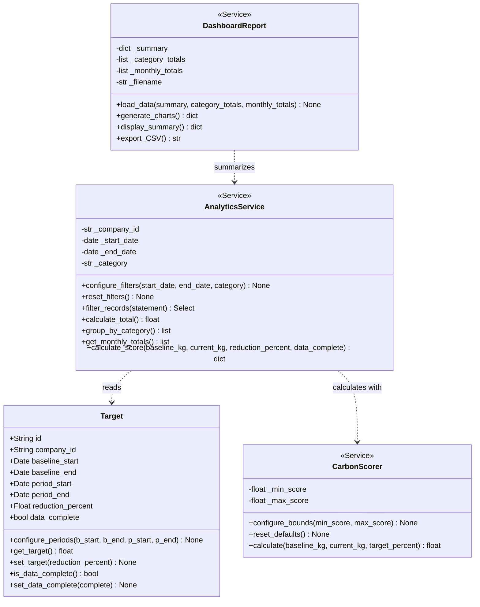
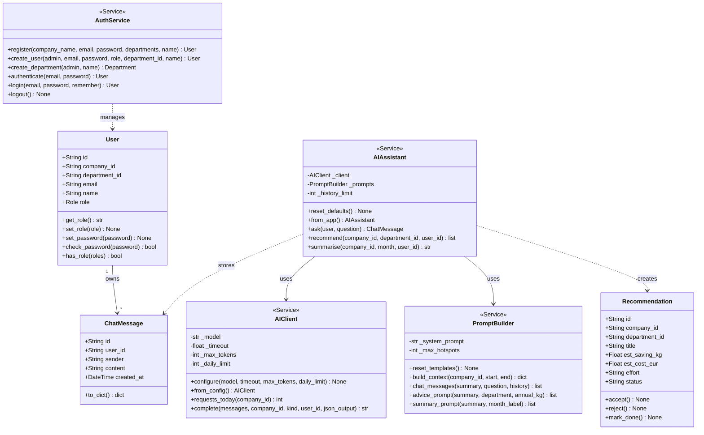

# 🌍 Enterprise Carbon Footprint Tracker & AI Assistant

[](https://www.python.org/)
[](https://palletsprojects.com/p/flask/)
[](https://www.postgresql.org/)
[](https://docs.docker.com/compose/)
[](https://docs.pytest.org/)
[](https://opensource.org/licenses/MIT)

> **Group 13 — Compact Programming (Capstone Project)  
> Fachhochschule Dortmund — University of Applied Sciences and Arts**

An enterprise-grade sustainability platform empowering small and mid-sized enterprises (SMEs) to track greenhouse gas emissions across **GHG Protocol Scopes 1, 2, and 3**, stream live operational telemetry into metric tons of $\text{CO}_2\text{e}$, visualize reduction trajectories via an interactive Plotly dashboard, and receive department-tailored decarbonization advice from an AI Sustainability Coach.

---

## 👥 Team Overview & Subsystem Ownership

| Subsystem | Team Member | Program | Matriculation ID | Core Package Ownership | Key Realized Deliverables |
|:---|:---|:---:|:---:|:---|:---|
| **S1** | **Mohammed Al-Amine Bennani** | MDT | `7222047` | `app/data_collection`<br>`app/models/` | Role-aware entry form, REST CRUD API, friendly CSV Importer, `EmissionCalculator`, Real-Time `StreamProcessor` pipeline |
| **S2** | **Vanessa Mukamanzi** | MDT | `7223964` | `app/analytics`<br>`app/models/target.py` | Company-isolated emissions aggregation, Plotly charts, CSV reports, reduction targets & `CarbonScorer` (0–100) |
| **S3** | **Junaid Ahmad** | MDT | `7222074` | `app/ai_assistant`<br>`app/user_access` | Company registration & salted password auth, RBAC (`Admin`, `Manager`, `Employee`), privacy-safe AI Coach |

---

## ✨ System Features at a Glance

### 📥 Subsystem 1: Data Collection & Real-Time Processing (S1)
* **Role-Aware Web UI (`/activities/new`):** Locks company identity to the user's tenant, populates department selections, and gives Admins the ability to record entries on behalf of company members.
* **Synchronous Calculation Preview:** Evaluates emissions via `POST /activities/api/calculate` in real time before persistence.
* **Friendly Batch CSV Ingestion (`CsvImporter`):** Ingests batches using either technical IDs or friendly names (`company, department, ...`) with cross-company upload validation.
* **Event-Driven Telemetry Stream Pipeline:** Ingests high-frequency flight bookings, server logs, and freight metrics through a Unix-piped (`|`) stream pipeline converting activity data into metric tons of $\text{CO}_2\text{e}$.

### 📊 Subsystem 2: Analytics & Visual Dashboard (S2)
* **Company-Isolated KPI Aggregations:** Computes Scope 1–3 emissions, monthly breakdowns, and consecutive percentage changes.
* **Interactive Visualizations:** Generates Plotly charts for emissions over time and distribution across operational categories.
* **Target Progress & Carbon Score:** Measures progress against baseline and evaluation reporting periods on a normalized 0–100 score.
* **Report Generation:** Exports date-filtered and category-filtered summaries to formatted UTF-8 CSV files.

### 🤖 Subsystem 3: AI Sustainability Coach & Access Control (S3)
* **Authentication & RBAC:** Multi-tenant registration, password salting (`werkzeug.security`), session state, and `@require_role` decorators.
* **Privacy-Preserving AI Coach:** Sends strictly aggregated figures (never row-level logs) to OpenAI or Google Gemini.
* **Department Recommendations:** Validates and saves structured JSON advice with estimated emissions savings, financial cost, and effort.
* **Dynamic Department Management:** Enables company admins to add departments on-the-fly and assign new users directly.

---

## 📐 System Design & UML Class Diagrams

### Subsystem 1 — Data Collection & Calculation (S1)



### Subsystem 2 — Analytics & Dashboard (S2)



### Subsystem 3 — AI Assistant & User Access (S3)



---

## 🏛️ Object-Oriented Concepts (Hometask 1)

Every subsystem incorporates fundamental OOP design patterns: explicit constructors (`__init__`), controlled state resets, and strict attribute encapsulation using `@property` accessors with defensive validation:

| Subsystem | Class | Encapsulation & Mutator Methods | Invariant & Validation Rules |
|:---|:---|:---|:---|
| **S1** | [`EmissionCalculator`](file:///c:/Users/MAAB/Desktop/CPC-Python-Capstone-Project/app/data_collection/calculations.py) | `@precision.setter`, `@property scope_mapping`, `register_scope_category()` | Precision constrained to `0 <= p <= 6`; scopes restricted to `{1, 2, 3}`. |
| **S1** | [`CsvImporter`](file:///c:/Users/MAAB/Desktop/CPC-Python-Capstone-Project/app/data_collection/csv_import.py) | `@encoding.setter`, `@property error_log`, `@property valid_count`, `initialize_session()` | Disallows empty encoding strings; protects internal counter and error list mutation. |
| **S1** | Domain Models (`app/models/`) | `is_valid()`, `update_quantity()`, `is_active(year)` | Protects negative activity quantities; ensures emission factor year matches report validity. |
| **S2** | `AnalyticsService` | `configure_filters()`, `reset_filters()`, `@property start_date`, `@property end_date` | Enforces `start_date <= end_date`; validates category existence against registered scopes. |
| **S2** | `DashboardReport` | `@filename.setter`, `generate_charts()`, `display_summary()`, `export_CSV()` | Rejects non-`.csv` filenames; maintains immutable cached dataset references. |
| **S2** | `CarbonScorer` | `@min_score.setter`, `@max_score.setter`, `reset_defaults()` | Guaranteed bounds invariant (`min_score < max_score`). |
| **S2** | `Target` | `set_target()`, `get_target()`, `set_data_complete()` | Bounded reduction percentages (`0.0% < target <= 100.0%`). |
| **S3** | `AIClient` | `configure()`, `@property model`, `@property timeout`, `@property daily_limit` | Timeout $> 0$, token budget $> 0$, daily request limit $\ge 0$. |
| **S3** | `PromptBuilder` | `@system_prompt.setter`, `@max_hotspots.setter`, `reset_templates()` | Rejects empty system prompts; enforces hotspot ceiling $\ge 1$. |
| **S3** | `AIAssistant` | `@history_limit.setter`, `reset_defaults()` | Enforces non-negative chat memory window size. |
| **S3** | `User` | `set_role()`, `get_role()`, `set_password()`, `check_password()` | Validates assignment against `Role.ALL` (`admin`, `manager`, `employee`). |

---

## ⚡ Real-Time Stream Processing Pipeline (Hometask 2)

An event-driven telemetry stream engine ([`stream_processing.py`](file:///c:/Users/MAAB/Desktop/CPC-Python-Capstone-Project/app/data_collection/stream_processing.py)) ingests operational telemetry events (`flight_booking`, `server_utility_log`, `freight_logistics`), filters by GHG Scope, and transforms activity values into metric tons of $\text{CO}_2\text{e}$:

* **Abstract Base Class Contract:** `StreamProcessor(ABC)` defines the abstract interface `@abstractmethod process(record)`.
* **Inheritance & Polymorphism:** Realized across concrete pipeline stages `ScopeFilter`, `MetricTonCO2eTransformer`, and `CompositeStreamProcessor`.
* **Operator Overloading:** Pipelines are composed using standard pipe `|` (`__or__`) or plus `+` (`__add__`) operators:
  ```python
  pipeline = ScopeFilter(target_scopes=3) | MetricTonCO2eTransformer()
  ```
* **Iterators & Lazy Generators:** `TelemetryStream` implements Python's iterator protocol (`__iter__` and `__next__`), while `process_stream()` lazily yields transformed records on demand.

### Stream Processing Architecture


---

## 🛠️ Technologies & Database Layer (Hometask 3)

* **Backend & Web Framework:** Python 3.12+, Flask 3, Flask-Login, Jinja2, RESTful JSON APIs & CSV data export.
* **Database Agnostic ORM (SQLAlchemy):**
  - **Docker Compose (Production-like):** PostgreSQL 16 (`postgresql+psycopg://...`) with relational foreign keys.
  - **Local Development:** SQLite (`sqlite:///carbon_dev.db`) with zero setup overhead.
  - **Enterprise Drop-in Compatible:** Native MySQL/MariaDB connectivity via `PyMySQL`.
* **Data Science & AI:** `pandas`, `Plotly.js` (interactive client-side graphs), OpenAI Python SDK with full Google Gemini support.

---

## 🧪 Automated Tests & Error Handling (Hometask 4)

The project includes an automated test suite of **187 unit and integration tests** achieving a **100% pass rate** across all subsystems (OpenAI calls mocked):

```text
============================= test session starts ==============================
collected 187 items

tests/test_subsystem1.py (13 tests) .............                       [  7%]
tests/test_stream_processing.py (13 tests) .............                [ 14%]
tests/test_analytics_services.py (16 tests) ................            [ 22%]
tests/test_analytics_scoring.py (14 tests) ..............               [ 30%]
tests/test_analytics_routes.py (18 tests) ..................            [ 39%]
tests/test_analytics_company_access.py (4 tests) ....                   [ 42%]
tests/test_s2_oop_and_exceptions.py (16 tests) ................         [ 50%]
tests/test_ai_assistant.py (38 tests) ..............................    [ 70%]
tests/test_ai_prompts.py (19 tests) ...................                 [ 81%]
tests/test_user_access.py (31 tests) ...............................    [ 97%]
tests/test_s3_oop.py (5 tests) .....                                    [100%]

============================= 187 passed in 65.67s =============================
```

### Custom Exception Hierarchies
* **Subsystem 1 ([`exceptions.py`](file:///c:/Users/MAAB/Desktop/CPC-Python-Capstone-Project/app/data_collection/exceptions.py)):**  
  `DataCollectionError` $\rightarrow$ `ValidationError` (`UnitMismatchError`, `PeriodValidationError`, `CompanyIsolationError`), `RecordOwnershipError` (HTTP 403), `ResourceNotFoundError` (HTTP 404).
* **Subsystem 2 ([`exceptions.py`](file:///c:/Users/MAAB/Desktop/CPC-Python-Capstone-Project/app/analytics/exceptions.py)):**  
  `AnalyticsError` $\rightarrow$ `InvalidFilterError`, `TargetValidationError`, `AnalyticsAccessError`.
* **Subsystem 3 ([`services.py`](file:///c:/Users/MAAB/Desktop/CPC-Python-Capstone-Project/app/ai_assistant/services.py)):**  
  `AuthError`, `AIUnavailable`, `InvalidAIOutput`.

---

## 🎯 Carbon Score Calculation

The **Carbon Score (0–100)** measures progress toward a company's target reduction percentage:

$$\text{Target Emissions} = \text{Baseline Emissions} \times \left(1 - \frac{\text{Reduction Target \%}}{100}\right)$$

$$\text{Score} = \min\left(100.0, \max\left(0.0, \frac{\text{Baseline Emissions} - \text{Current Emissions}}{\text{Baseline Emissions} - \text{Target Emissions}} \times 100\right)\right)$$

* **Complete Evaluation:** Requires activity records in both the baseline and evaluation periods with `data_complete=True`.
* **Calibrated Seed Data:** Baseline: 4,200 kg $\text{CO}_2\text{e}$ (August 2026), Evaluation: 3,612 kg $\text{CO}_2\text{e}$ (October 2026), Target: 20% reduction $\rightarrow$ **Score = 70.0 / 100**.

---

## 🚀 How to Run the Program

Follow these step-by-step instructions to get the application running.

### Option 1: Run with Docker (Recommended)

1. **Configure Environment:**
   Copy the example environment file:
   ```bash
   # Windows PowerShell
   Copy-Item .env.example .env

   # macOS / Linux / Git Bash
   cp .env.example .env
   ```
   Open `.env` and add your API key for the AI assistant:
   ```env
   OPENAI_API_KEY=your-gemini-or-openai-key
   ```
   *(For a free Google Gemini key from Google AI Studio: set `OPENAI_BASE_URL=https://generativelanguage.googleapis.com/v1beta/openai/` and `OPENAI_MODEL=gemini-flash-lite-latest`)*

2. **Start the Containers:**
   Build and start PostgreSQL, the Web application, and Adminer in the background:
   ```bash
   docker compose up -d --build
   ```

3. **Seed the Database:**
   Populate standard emission factors, the demo company (*Test Corp*), calibrated reduction targets, and demo user accounts:
   ```bash
   docker compose exec web python seed.py
   ```

4. **Open in Your Browser:**
   - **Web Application:** [http://localhost:5000](http://localhost:5000)
     - **Admin Login:** `admin@testcorp.com` | Password: `password123`
     - **Employee Login:** `employee@testcorp.com` | Password: `password123`
   - **Database Management GUI (Adminer):** [http://localhost:3333](http://localhost:3333)
     - System: `PostgreSQL` | Server: `db` | Database: `carbon_tracker` | Username: `carbon_user` | Password: `password123`

> [!NOTE]
> **Testing CSV Upload (`test_records.csv` & `test_activities.csv`):**
> - The batch upload (`/activities/new`) supports human-friendly CSV headers (`company, department, factor_id, ...`).
> - **Company Match:** The `company` value in your CSV must match your currently logged-in company name (e.g. `Test Corp`). Uploading records for another company is blocked for multi-tenant isolation.
> - **Department Verification:** The `department` listed in the CSV must already exist in your company (e.g. `IT`). If a department does not exist (e.g. `Operations`), the upload will reject it with a clear error prompting you to create it first under **User Access** (`/auth/users`) as Admin.

5. **Run Automated Tests:**
   ```bash
   docker compose exec web pytest -q
   ```
   *(To stop the containers: `docker compose down`)*

6. **Reset / Clean Database (Optional):**
   To completely wipe the database volume and re-seed from scratch:
   ```bash
   docker compose down -v
   docker compose up -d
   docker compose exec web python seed.py
   ```

---

### Option 2: Run Locally (Python Virtual Environment)

1. **Create and Activate Virtual Environment:**
   ```powershell
   # Windows PowerShell
   python -m venv .venv
   .\.venv\Scripts\Activate.ps1
   Copy-Item .env.example .env
   ```
   ```bash
   # macOS / Linux
   python -m venv .venv
   source .venv/bin/activate
   cp .env.example .env
   ```

2. **Install Dependencies:**
   ```bash
   pip install -r requirements.txt
   ```

3. **Configure `.env` (SQLite fallback):**
   ```env
   SECRET_KEY=replace-with-a-random-local-secret
   DATABASE_URL=sqlite:///carbon_dev.db
   OPENAI_API_KEY=your-gemini-or-openai-key
   ```
   *(For free Google Gemini: add `OPENAI_BASE_URL=https://generativelanguage.googleapis.com/v1beta/openai/` and `OPENAI_MODEL=gemini-flash-lite-latest`)*

4. **Seed Database & Start Server:**
   ```bash
   python seed.py
   python run.py
   ```
   Open [http://127.0.0.1:5000](http://127.0.0.1:5000).

5. **Reset / Clean Database Locally (Optional):**
   To delete the local SQLite database and re-seed:
   ```bash
   # Windows PowerShell
   Remove-Item carbon_dev.db
   python seed.py

   # macOS / Linux
   rm carbon_dev.db
   python seed.py
   ```

---

## 🤝 Team Workflow

We collaborate on GitHub feature branches with pull request reviews before merging into `main`. Shared model or interface modifications are reviewed by the respective subsystem leads. Environment variables, database files, and API secrets are strictly kept out of version control.
