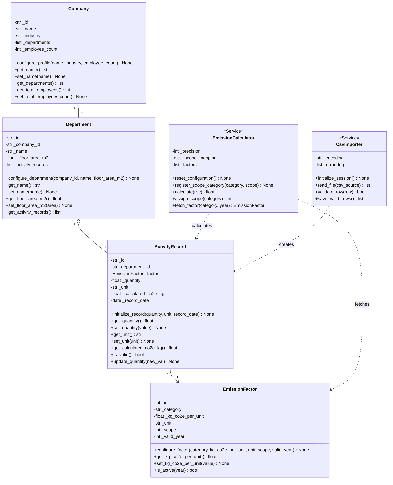
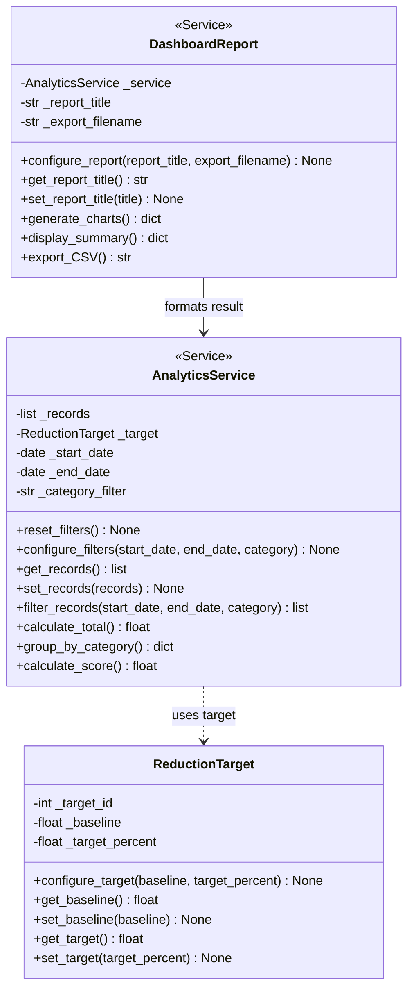
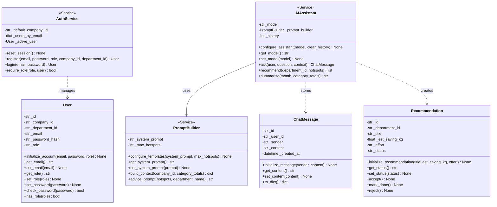

# Enterprise Carbon Footprint Tracker & AI Assistant — Hometask 1 (OOP Concepts)

**Group 13 — Compact Programming, FH Dortmund**

This branch (`Homeassignment1`) contains the pure Object-Oriented Programming (OOP) translation of our Group 13 Capstone Project UML class diagrams across all three subsystems. Every class implements explicit state initialization (`__init__`), configuration/setup methods, and encapsulated getters & setters with domain validation.

---

## Team Overview

| Team Member | Program | Matriculation ID | Assigned Subsystem | Implemented OOP Classes (≥ 3 per Member) |
|---|---|---|---|---|
| **Mohammed Al-Amine Bennani** | MDT | `7222047` | **S1 — Data Collection & Calculation** (`app/data_collection/`, `app/models/`) | `Company`, `Department`, `EmissionFactor`, `ActivityRecord`, `EmissionCalculator`, `CsvImporter` |
| **Vanessa Mukamanzi** | MDT | `7223964` | **S2 — Analytics & Dashboard** (`app/analytics/`, `app/models/target.py`) | `ReductionTarget`, `AnalyticsService`, `DashboardReport` |
| **Junaid Ahmad** | MDT | `7222074` | **S3 — AI Assistant & User Access** (`app/user_access/`, `app/ai_assistant/`, `app/models/`) | `User`, `ChatMessage`, `Recommendation`, `AuthService`, `PromptBuilder`, `AIAssistant` |

---

## Directory Structure

```text
.
├── README.md
├── demo.py                      # Runnable OOP demonstration across S1, S2, and S3
└── app/
    ├── models/                  # Domain models (Company, Department, EmissionFactor, ActivityRecord, Target, User, ChatMessage, Recommendation)
    ├── data_collection/         # S1 — Mohammed Al-Amine Bennani (7222047): EmissionCalculator, CsvImporter
    ├── analytics/               # S2 — Vanessa Mukamanzi (7223964): AnalyticsService, DashboardReport, CarbonScorer
    ├── user_access/             # S3 — Junaid Ahmad (7222074): AuthService
    └── ai_assistant/            # S3 — Junaid Ahmad (7222074): PromptBuilder, AIAssistant
```

---

## System Design (UML Class Diagrams)

### Subsystem 1 — Data Collection & Calculation (Mohammed Al-Amine Bennani · `7222047`)



### Subsystem 2 — Analytics & Dashboard (Vanessa Mukamanzi · `7223964`)



### Subsystem 3 — AI Assistant & User Access (Junaid Ahmad · `7222074`)



---

## Running the OOP Verification Demo

No external libraries are required (Python 3.10+ standard library only):

```bash
python demo.py
```
